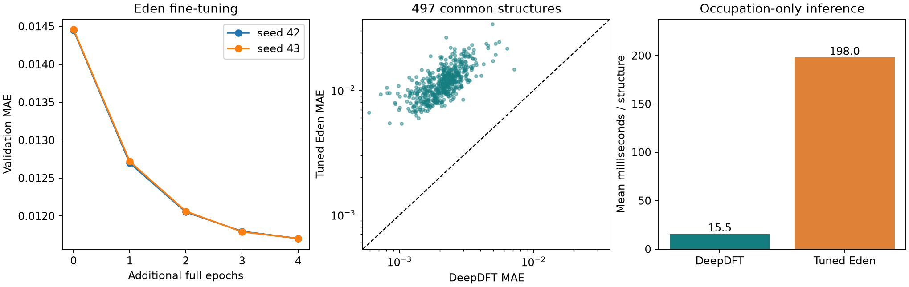

# EdenGNN 全参数微调与 DeepDFT：NMC occupation 对照

主表使用同一批 497 个结构；官方 500 个测试结构中有 3 个曾用于 Eden 的密度预训练，所以仅作为补充给出 500 结构结果。模型选择没有使用本轮测试指标。

| 模型 | seed | occupation MAE | 相对 L1 (%) |
|---|---:|---:|---:|
| deep_frozen | 42 | 0.002159 | 0.800 |
| deep_frozen | 43 | 0.002250 | 0.834 |
| eden_frozen | 42 | 0.015197 | 5.620 |
| eden_frozen | 43 | 0.015206 | 5.624 |
| eden_finetuned | 42 | 0.011951 | 4.439 |
| eden_finetuned | 43 | 0.011953 | 4.439 |

| 两种子平均 | MAE | 相对 L1 (%) | L=0 MAE | L=1 MAE | L=2 MAE |
|---|---:|---:|---:|---:|---:|
| deep_frozen | 0.002204 | 0.817 | 0.003183 | 0.000552 | 0.002952 |
| eden_frozen | 0.015202 | 5.622 | 0.034119 | 0.004508 | 0.016549 |
| eden_finetuned | 0.011952 | 4.439 | 0.033270 | 0.003806 | 0.011081 |

按结构配对，微调 Eden 减 DeepDFT 的 MAE 差为 +0.009748；结构自助抽样描述性 95% 区间 [+0.009467, +0.010035]。两种子取平均后，Eden 在 0/497 个结构上的 MAE 更低。区间不包含训练种子或数据分布变化的不确定性。

| seed | 初始验证 MAE | 选中轮次 | 最佳微调验证 MAE | 含重叠的 500 结构 MAE |
|---|---:|---:|---:|---:|
| 42 | 0.014448 | 4 | 0.011703 | 0.011935 |
| 43 | 0.014458 | 4 | 0.011702 | 0.011936 |

50 结构预热计时：DeepDFT 15.54 ms/结构，Eden 全参数微调模型 197.99 ms/结构。Eden/DeepDFT 耗时比 12.74。每个结构交替顺序、各 2 次预热和 5 次同步重复，按每结构中位数再平均。只测 occupation，含新构图与编码，不含文件读写、模型初始化和密度网格。

两个 Eden 种子分别从对应的冻结头检查点继续训练（1450/50/500 划分），解冻完整编码器和 augmentation 头，每种子新增 4 个完整 epoch。验证选择限于微调轮次；初始模型作为独立对照。DeepDFT 报告的是之前锁定的冻结官方主干和新训练的几何头。预算、预训练数据和头容量不同，不作为架构上限排名。非磁性 NMC、L≤2；没有评估高阶 PAW、联合密度模型或 VASP 收敛。

协议：protocol.md。全参数权重、梯度更新量、每结构/角阶/元素误差与各次计时保存在 runs/eden_full_finetune_2026-11-02；训练入口 scripts/finetune_public_eden.py。

运行记录：种子 43 的首次第 1 轮因 Windows 共享显存分页减速，在生成检查点前中断。从原始检查点和相同种子重跑，仅增加了释放闲置 CUDA 缓存的条件。首次日志、原始源码和修复说明分别保存在 initial_run.log、original_training_source.py 和 runtime_note.txt。

