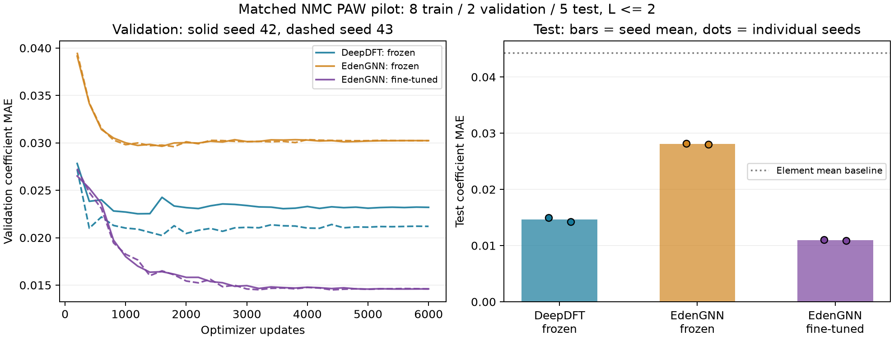

# EdenGNN 与 DeepDFT 的匹配 PAW occupation 对照

本报告比较同一批 NMC 结构上的 VASP 原子中心 augmentation 实球张量系数。这里的 occupation 不是能带占据数。所有模型使用同一标签映射、有效分量掩码、训练统计和指标。

两种子平均测试 MAE：冻结 DeepDFT 为 0.014628，冻结 Eden 为 0.028070，整体微调 Eden 为 0.010965。微调 Eden 比冻结 DeepDFT 降低 25.0% MAE。

冻结 Eden 的简单线性头未追平 DeepDFT 的几何头；针对 occupation 调整整个 Eden 编码器后，测试精度提高。这个对照说明训练目标和可调整的表示有实际影响，但输出头容量、编码器规模和更新范围同时不同，不能据此断言 Eden 架构本身更优，或 DeepDFT 无法达到这一精度。

本地普通执行的完整 occupation 路径为 DeepDFT 16.2 ms/结构、微调 Eden 196.7 ms/结构。Eden 的输出头虽小，编码器成本仍占主要部分；这个计时不评价完整网格密度任务的速度。

## 测试结果

MAE 无量纲：先对每个结构的有效系数取平均绝对误差，再对五个结构平均。相对 L1 的分母是系数绝对值之和，不能与电子密度 NMAE 直接比较。以下报告全部种子，没有按测试结果选种子。

| 方法／种子 | 训练 MAE | 验证 MAE | 测试 MAE | 相对 L1 (%) | 比元素均值基线降低 MAE |
|---|---:|---:|---:|---:|---:|
| element_mean | 0.037698 | 0.046768 | 0.044233 | 17.285 | 0.00% |
| DeepDFT_frozen_42 | 0.003994 | 0.022520 | 0.014982 | 5.824 | 66.13% |
| DeepDFT_frozen_43 | 0.003306 | 0.020233 | 0.014275 | 5.550 | 67.73% |
| EdenGNN_frozen_42 | 0.017174 | 0.029636 | 0.028166 | 10.995 | 36.32% |
| EdenGNN_frozen_43 | 0.016927 | 0.029598 | 0.027974 | 10.919 | 36.76% |
| EdenGNN_finetuned_42 | 0.001683 | 0.014580 | 0.011027 | 4.292 | 75.07% |
| EdenGNN_finetuned_43 | 0.001700 | 0.014494 | 0.010902 | 4.244 | 75.35% |

两种子汇总仅表示本次训练重复性，不是统计置信区间。Eden 冻结组对应“直接复用密度表示”；微调组另行训练 occupation 编码器，参数更新范围比 DeepDFT 冻结组更大。不能把差异全部归因于架构。

| 方法 | 两种子平均测试 MAE | 两种子平均相对 L1 (%) |
|---|---:|---:|
| DeepDFT_frozen | 0.014628 | 5.687 |
| EdenGNN_frozen | 0.028070 | 10.957 |
| EdenGNN_finetuned | 0.010965 | 4.268 |

## 角阶分解

| 方法／种子 | L=0 MAE | L=1 MAE | L=2 MAE | L>0 MAE | L>0 相对 L1 (%) |
|---|---:|---:|---:|---:|---:|
| element_mean | 0.103787 | 0.012724 | 0.047168 | 0.034004 | 100.000 |
| DeepDFT_frozen_42 | 0.062310 | 0.002753 | 0.009528 | 0.006941 | 18.640 |
| DeepDFT_frozen_43 | 0.060706 | 0.002479 | 0.008775 | 0.006374 | 17.050 |
| EdenGNN_frozen_42 | 0.099289 | 0.004637 | 0.022963 | 0.015976 | 45.152 |
| EdenGNN_frozen_43 | 0.098746 | 0.004600 | 0.022778 | 0.015849 | 44.773 |
| EdenGNN_finetuned_42 | 0.044322 | 0.001513 | 0.007755 | 0.005373 | 14.527 |
| EdenGNN_finetuned_43 | 0.042320 | 0.001641 | 0.007999 | 0.005571 | 15.017 |

## 逐结构测试 MAE

| 结构 | element_mean | DeepDFT_frozen_42 | DeepDFT_frozen_43 | EdenGNN_frozen_42 | EdenGNN_frozen_43 | EdenGNN_finetuned_42 | EdenGNN_finetuned_43 |
|---|---:|---:|---:|---:|---:|---:|---:|
| scf_361 | 0.029209 | 0.002406 | 0.002731 | 0.017236 | 0.016957 | 0.002721 | 0.002781 |
| scf_796 | 0.027778 | 0.003304 | 0.003556 | 0.011980 | 0.011767 | 0.002586 | 0.002370 |
| scf_825 | 0.046342 | 0.021394 | 0.020083 | 0.028289 | 0.028085 | 0.013493 | 0.013424 |
| scf_1056 | 0.062016 | 0.025436 | 0.024262 | 0.045255 | 0.045343 | 0.018293 | 0.018022 |
| scf_1749 | 0.055818 | 0.022369 | 0.020741 | 0.038069 | 0.037719 | 0.018043 | 0.017914 |

## 推理耗时

| 方法／种子 | 仅 occupation 头 (ms/结构) | 新构图＋编码器＋occupation 头 (ms/结构) |
|---|---:|---:|
| DeepDFT_frozen_42 | 4.563 | 16.291 |
| DeepDFT_frozen_43 | 4.311 | 16.157 |
| EdenGNN_frozen_42 | 3.168 | 194.919 |
| EdenGNN_frozen_43 | 3.529 | 195.043 |
| EdenGNN_finetuned_42 | 3.862 | 203.020 |
| EdenGNN_finetuned_43 | 3.174 | 190.355 |

在同一 RTX 5060 Ti 上，五个测试结构分别预热三次、CUDA 同步测量十次取中位数，再逐结构平均。完整 occupation 推理每次重新构图和计算原子特征；不借用其他结构的表示。均不包含文件／模型加载和完整网格密度解码。DeepDFT 时间来自前一轮已保存的相同计时协议，未在本轮交错重测，细微差异不宜过度解读。

Eden 训练用 CUDA Graph，正式推理耗时全部用普通 eager 执行。不能把本地 Python 实现的计时当成论文优化部署性能。头本身计时假设已有特征；微调的独立 occupation 编码器不能与原密度编码器共用同一份特征，因此实际使用还要支付该编码器的成本。

## 训练范围与成本

Eden 原子编码器含 6,190,078 个参数；官方等变线性 occupation 头经 NMC 输出适配后含 946 个参数。DeepDFT 自定义几何等变头含 49,899 个参数。不同编码器和输出头不做参数量或 FLOPs 匹配。

| 方法／种子 | 验证选中步骤 | 可训练参数 | 训练秒数 |
|---|---:|---:|---:|
| DeepDFT_frozen_42 | 1200 | 49,899 | 152.9 |
| DeepDFT_frozen_43 | 1600 | 49,899 | 154.6 |
| EdenGNN_frozen_42 | 1600 | 946 | 139.1 |
| EdenGNN_frozen_43 | 1800 | 946 | 140.1 |
| EdenGNN_finetuned_42 | 5000 | 6,191,024 | 2282.0 |
| EdenGNN_finetuned_43 | 4400 | 6,191,024 | 2258.9 |

每组训练 6000 个优化步骤，batch=2 个不同结构，使用相同种子的同一采样序列；Adam 1e-3→1e-5 cosine、梯度裁剪 5、训练统计标准化后的 MSE，每 200 步用验证集原始系数 MAE 选模。匹配的是更新次数和样本预算，不是墙钟时间。训练秒数不含前置数据准备和 CUDA Graph 捕获。

两种 Eden 模式都从原八结构密度检查点开始。冻结组只更新线性头，并可缓存不变的训练特征；微调组更新独立副本的整个编码器及头，每次重新计算训练特征。原密度检查点未改动；不把微调后的 occupation 编码器替换进原密度模型，也未验证替换后的密度精度。

## 数值条件修正及记录

预试验中，不缩放特征的冻结 seed 42 在 6000 步内训练 MAE 仅由约 0.03770 降至 0.03707。预训练编码器 L=1、L=2 特征 RMS 约为 0.0055、0.0025，新建零初始化线性头在既定学习率下学习缓慢。

在查看本轮测试误差前修改了协议：用训练原子上的 RMS 缩放每个 irrep 通道，同一通道所有 m 共用一个标量，设下限 1e-4；固定用于两个正式组。它保持等变性和线性表达能力，但改变优化条件。原不缩放 seed 42 完整记录、被中断的 seed 43 和原源码快照均保留于 runs/edengnn_paw_2026-10-30。正式结果独立保存在 runs/edengnn_paw_scaled_2026-10-30，不混用预试验。

## 数据与结论边界

- 训练 8 个结构（cache 0–7），验证 2 个（SCF 170、314），测试 5 个（361、796、825、1056、1749）。与训练重复的 SCF 1、3、6 已剔除，其余通过严格周期结构匹配检查。
- 本轮沿用 DeepDFT 已报告的小测试集，不是全新盲测。所有 Eden 模型均在测试前完成验证选模；未根据新测试结果改变结构、训练预算或种子。
- 现有 CHGCAR 中 L=3、4 槽位均为零且历史 LMAXMIX 无法独立确认，因此仅训练和评价 L≤2。高阶槽位输出零仅作占位，不能声称完整 d 通道 PAW 初始化已验证。
- 投影子次序按本地 POTCAR 建立映射，SCF 副本标题匹配；原 CHGCAR 不记录完整 POTCAR 身份，历史版本仍有溯源限制。
- 本轮是官方 Eden 编码器和线性 augmentation 头的本地适配，不是论文通用模型、数据集或训练流程的复现。不能与论文的通用模型 occupation MAE 直接排名。
- 尚未运行 VASP，不据此声称 SCF 迭代减少、总耗时下降或最终能量／力精度提高。

## 核对与复现

CUDA Graph 审核覆盖全部八个训练结构、双结构梯度累积及更新后的参数；最大输出差 4.77e-07，最大梯度相对 L2 差 1.77e-07。核对使用非零输出头，避免编码器梯度为零造成无效验证。

正式评估重新计算所有模型的原子特征；冻结组额外验证缓存／新计算结果一致。所有四个检查点均通过真实测试结构上的旋转、反演和平移等变性检查。来源代码、原 Eden 检查点、DeepDFT 数据与结果哈希审核通过。

本轮 13 项相关回归测试通过，涵盖 PAW 输出头、原生系数往返、Eden 适配器、DeepDFT 消息计算和推理；日志位于 runs/edengnn_paw_scaled_2026-10-30/tests.log。各组 best.pt、selection.json、history.json、逐结构 prediction.npz，以及原始误差、逐元素分解和计时均保存在正式 runs 目录。详细协议见同目录报告 protocol.md。

复现：依次运行 `python -m scripts.benchmark_edengnn_paw --stage prepare`、`--stage audit`，分别运行 `--stage train --arm frozen/finetuned --seed 42/43`，全部完成后运行 `--stage final`，最后 `python -m scripts.summarize_edengnn_paw`。已有结果禁止覆盖，重跑用 `--root` 指向新目录并相应调整汇总入口。
