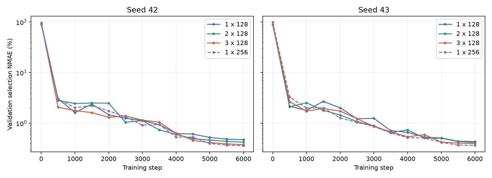
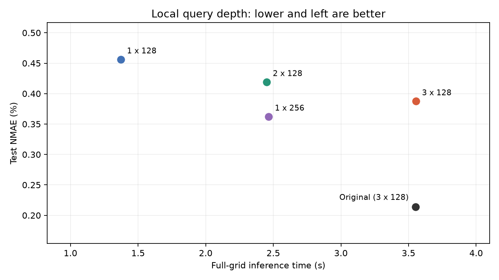

# Local 查询头增加层数：固定 128 通道

新增 2×128、3×128 查询头，原子编码器冻结，与已有单层 128/256 和原 DeepDFT 同进程比较。每个新模型两个种子，各训练 6000 步。

## 精度与新输入完整推理

| 查询结构 | 测试 NMAE (%) | 完整网格 (s) | 相对原模型加速 | 查询侧启用参数 | 相对单层128误差降幅 (%) |
|---|---:|---:|---:|---:|---:|
| 原 DeepDFT：3×128 | 0.214090 | 3.552680 | 1.00× | 892545 | 53.07 |
| local：1×128 | 0.456175 | 1.373012 | 2.59× | 407041 | 0.00 |
| local：2×128 | 0.418997 | 2.451668 | 1.45× | 699009 | 8.15 |
| local：3×128 | 0.387381 | 3.554419 | 1.00× | 990977 | 15.08 |
| local：1×256 | 0.362217 | 2.466616 | 1.44× | 1403905 | 20.60 |

误差为 8 个结构的空间测试 NMAE 宏平均，再对两个训练种子平均。耗时预先指定种子 42，每结构三次交错测量中位数，再对 8 个结构平均。所有模型另共用 594688 参数的原子编码器。

## 分种子结果

| 查询头 | 种子 | 最优验证步 | selection NMAE (%) | test NMAE (%) |
|---|---:|---:|---:|---:|
| local：1×128 | 42 | 6000 | 0.471025 | 0.475124 |
| local：1×128 | 43 | 6000 | 0.433881 | 0.437226 |
| local：2×128 | 42 | 6000 | 0.421813 | 0.423083 |
| local：2×128 | 43 | 6000 | 0.413668 | 0.414912 |
| local：3×128 | 42 | 6000 | 0.375976 | 0.378123 |
| local：3×128 | 43 | 6000 | 0.394032 | 0.396640 |
| local：1×256 | 42 | 6000 | 0.357810 | 0.358644 |
| local：1×256 | 43 | 6000 | 0.363677 | 0.365789 |

## 增加的具体计算

- 原子编码器的三层标量/向量特征拼接，投影成 128 通道的原子表示，每结构只计算一次。
- 各查询层使用同一原子表示，但有独立消息 MLP、径向滤波、门控和 PaiNN update。查询标量/向量状态逐层递推；每层重新计算边消息及聚合。几何、距离编码在层间共享。
- 增加查询层不增加共享原子 embedding 的 128 通道容量。本轮没有测试逐层独立原子投影；共享表示是否限制最终精度，需要另行消融，不能仅由这组结果确定。
- depth=1 与上一轮单层实现的输出和梯度一致；没有改变 4 Å 邻域或 30 维径向编码。无 global、SAD、插值和电荷后处理。
- 单层 256 保留为宽度参照，以便对比更深和更宽的精度/时间成本。

## 训练、计时和结论边界

- 新头种子 42/43，6000 步，每步 1024 个训练点；原 80/10/10 空间划分、训练点顺序、Adam、cosine 学习率、归一化 L1、裁剪阈值均保持一致。
- 仅按原验证 selection 选择检查点；所有新配置训练结束后统一测试。旧单层检查点直接复用，不重新选择。测试集已用于前序研究，不是新的盲测。
- 新增层沿用旧单层第一层及投影的同种子初始权重，但额外层使初始函数不同；不宣称不同深度初始预测一致。
- 原 DeepDFT 参照经过 16000 步端到端训练；本轮是冻结原子编码器、随机初始化查询头的 6000 步训练。
- 新 3×128 与原 DeepDFT 不是完全相同的查询结构：本轮各层用共享投影后的拼接原子特征，原模型每层用对应原子层的特征。不能把差距全部归因于训练步数，也不能视作新结构充分训练后的上限。
- 每次计时重新构建原子/查询图、运行原子网络、原子投影和全部 439040 点查询。未使用训练特征缓存；文件/检查点加载和驻留输入传输不计入。
- RTX 5060 Ti、float32 网络、TF32 关闭，先预热，显式 CUDA 同步、同进程交错三轮。逐结构核对缓存评估与新输入完整推理的测试误差一致。
- 只验证已见 8 个结构内空间留出，不证明未见结构泛化、MD 新帧表现或 SCF 收敛。

## 每结构测试误差

| 查询头 | 种子 | 结构 | NMAE (%) |
|---|---:|---:|---:|
| local：1×128 | 42 | 0 | 0.434150 |
| local：1×128 | 42 | 1 | 0.320682 |
| local：1×128 | 42 | 2 | 0.540339 |
| local：1×128 | 42 | 3 | 0.550047 |
| local：1×128 | 42 | 4 | 0.496784 |
| local：1×128 | 42 | 5 | 0.641340 |
| local：1×128 | 42 | 6 | 0.418668 |
| local：1×128 | 42 | 7 | 0.398984 |
| local：1×128 | 43 | 0 | 0.404408 |
| local：1×128 | 43 | 1 | 0.300849 |
| local：1×128 | 43 | 2 | 0.526711 |
| local：1×128 | 43 | 3 | 0.469685 |
| local：1×128 | 43 | 4 | 0.468034 |
| local：1×128 | 43 | 5 | 0.579233 |
| local：1×128 | 43 | 6 | 0.379916 |
| local：1×128 | 43 | 7 | 0.368969 |
| local：1×256 | 42 | 0 | 0.338852 |
| local：1×256 | 42 | 1 | 0.241677 |
| local：1×256 | 42 | 2 | 0.430655 |
| local：1×256 | 42 | 3 | 0.364750 |
| local：1×256 | 42 | 4 | 0.393829 |
| local：1×256 | 42 | 5 | 0.474084 |
| local：1×256 | 42 | 6 | 0.311856 |
| local：1×256 | 42 | 7 | 0.313454 |
| local：1×256 | 43 | 0 | 0.341837 |
| local：1×256 | 43 | 1 | 0.255090 |
| local：1×256 | 43 | 2 | 0.438124 |
| local：1×256 | 43 | 3 | 0.375906 |
| local：1×256 | 43 | 4 | 0.394537 |
| local：1×256 | 43 | 5 | 0.488224 |
| local：1×256 | 43 | 6 | 0.312687 |
| local：1×256 | 43 | 7 | 0.319905 |
| local：2×128 | 42 | 0 | 0.391808 |
| local：2×128 | 42 | 1 | 0.283845 |
| local：2×128 | 42 | 2 | 0.511703 |
| local：2×128 | 42 | 3 | 0.441719 |
| local：2×128 | 42 | 4 | 0.455185 |
| local：2×128 | 42 | 5 | 0.569489 |
| local：2×128 | 42 | 6 | 0.364089 |
| local：2×128 | 42 | 7 | 0.366826 |
| local：2×128 | 43 | 0 | 0.380208 |
| local：2×128 | 43 | 1 | 0.278284 |
| local：2×128 | 43 | 2 | 0.495749 |
| local：2×128 | 43 | 3 | 0.439751 |
| local：2×128 | 43 | 4 | 0.450626 |
| local：2×128 | 43 | 5 | 0.563774 |
| local：2×128 | 43 | 6 | 0.354079 |
| local：2×128 | 43 | 7 | 0.356822 |
| local：3×128 | 42 | 0 | 0.358139 |
| local：3×128 | 42 | 1 | 0.248510 |
| local：3×128 | 42 | 2 | 0.452868 |
| local：3×128 | 42 | 3 | 0.395123 |
| local：3×128 | 42 | 4 | 0.410395 |
| local：3×128 | 42 | 5 | 0.509650 |
| local：3×128 | 42 | 6 | 0.325780 |
| local：3×128 | 42 | 7 | 0.324519 |
| local：3×128 | 43 | 0 | 0.366643 |
| local：3×128 | 43 | 1 | 0.265795 |
| local：3×128 | 43 | 2 | 0.477591 |
| local：3×128 | 43 | 3 | 0.415869 |
| local：3×128 | 43 | 4 | 0.425804 |
| local：3×128 | 43 | 5 | 0.539859 |
| local：3×128 | 43 | 6 | 0.336495 |
| local：3×128 | 43 | 7 | 0.345062 |

## 检查与复现

完整回归：10 项测试通过。

新增检查覆盖 depth=1 与旧实现的输出/梯度一致性、多层旋转不变性、分块一致性和每层消息参数都有有限梯度。完整回归日志位于 runs/local_depth_2026-10-30/tests.log。

```powershell
& 'C:/Users/User/.conda/envs/kan-cgcnn-cuda/python.exe' -m scripts.verify_local_depth
& 'C:/Users/User/.conda/envs/kan-cgcnn-cuda/python.exe' -m scripts.summarize_local_depth
```




