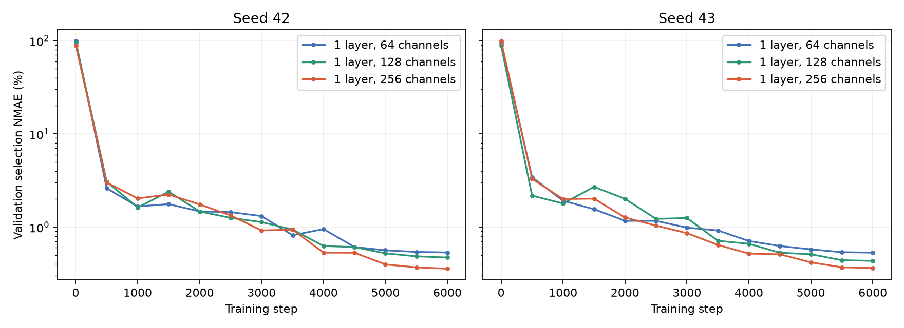
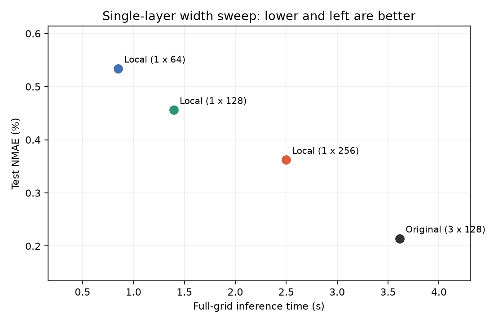

# 单层 local 查询网络：增宽到 128 / 256 通道

本轮单层模型最低平均测试误差来自 256 通道，为 0.362217%；原三层 128 通道模型为 0.214090%。该单层模型误差是原模型的 1.692 倍，新输入完整网格速度是原优化接口的 1.45 倍。

## 误差与速度

误差为 8 个结构空间留出的测试 NMAE 宏平均，再对两个训练种子取平均。速度使用预先指定种子 42，各结构三次交错测量中位数再宏平均。

| 查询结构 | 测试 NMAE (%) | 完整网格 (s) | 加速 | 相对原模型误差倍数 | 查询侧启用参数 |
|---|---:|---:|---:|---:|---:|
| 原模型：3 层 × 128 | 0.214090 | 3.614069 | 1.00× | 1.000 | 892545 |
| local：1 层 × 64 | 0.534085 | 0.850143 | 4.25× | 2.495 | 129793 |
| local：1 层 × 128 | 0.456175 | 1.394350 | 2.59× | 2.131 | 407041 |
| local：1 层 × 256 | 0.362217 | 2.497372 | 1.45× | 1.692 | 1403905 |

所有模型共用同一个 594688 参数原子编码器。单层模型查询侧计数不含已关闭、未使用的 global 模块。

## 分种子结果

| 通道 | 种子 | 最优验证步 | 验证 selection (%) | 独立空间测试 (%) |
|---:|---:|---:|---:|---:|
| 64 | 42 | 6000 | 0.533328 | 0.535452 |
| 64 | 43 | 6000 | 0.531338 | 0.532718 |
| 128 | 42 | 6000 | 0.471025 | 0.475124 |
| 128 | 43 | 6000 | 0.433881 | 0.437226 |
| 256 | 42 | 6000 | 0.357810 | 0.358644 |
| 256 | 43 | 6000 | 0.363677 | 0.365789 |

## 设置与解释边界

- 单层公式与上一轮完全一致：三层冻结原子特征拼接、一次原子投影、一次局域消息聚合、一次 PaiNN update 和标量读出。
- 本轮只把单层通道从 64 扩到 128、256；邻域仍为 4 Å，径向编码仍为 30，无 global、SAD、密度插值或电荷后处理。
- 128/256 每个宽度两个种子各训练 6000 步，每步 1024 个训练查询点；64 直接复用上一轮同预算检查点。训练结构顺序、查询点序列、优化器和验证选择规则一致。不同宽度的随机权重形状不同，不宣称初始函数相同。
- 原 DeepDFT 参照是 16000 步端到端训练；本轮冻结原子编码器，只重训单层头。与原模型的差距不能全部归因于层数，也不代表单层架构在更多训练或联合微调后的上限。
- 检查点仅由固定验证 selection 选择，全部宽度训练完才统一评估测试。测试集曾用于此前研究，非新的盲测数据集。所有预定宽度及种子均报告，不按测试挑选种子。
- 8 个结构均被训练见过，只有网格点留出；没有测试结构外推或 SCF 收敛。
- 本轮重新计时全部四种模型。每次重建原子图与查询图、重算原子编码与投影，输出每结构 439040 个点。缓存的训练特征没有进入计时路径；文件读取、检查点加载和驻留输入传输不计入。
- RTX 5060 Ti，float32 网络、TF32 关闭；先预热，显式 CUDA 同步，同进程交错三轮。逐结构检查完整推理路径与缓存评估路径的测试误差一致。

## 每结构误差

| 通道 | 种子 | 结构 | 测试 NMAE (%) |
|---:|---:|---:|---:|
| 64 | 42 | 0 | 0.477055 |
| 64 | 42 | 1 | 0.370413 |
| 64 | 42 | 2 | 0.622420 |
| 64 | 42 | 3 | 0.614204 |
| 64 | 42 | 4 | 0.565830 |
| 64 | 42 | 5 | 0.705426 |
| 64 | 42 | 6 | 0.463136 |
| 64 | 42 | 7 | 0.465133 |
| 64 | 43 | 0 | 0.465575 |
| 64 | 43 | 1 | 0.366085 |
| 64 | 43 | 2 | 0.646578 |
| 64 | 43 | 3 | 0.569900 |
| 64 | 43 | 4 | 0.581225 |
| 64 | 43 | 5 | 0.694627 |
| 64 | 43 | 6 | 0.469203 |
| 64 | 43 | 7 | 0.468550 |
| 128 | 42 | 0 | 0.434150 |
| 128 | 42 | 1 | 0.320682 |
| 128 | 42 | 2 | 0.540339 |
| 128 | 42 | 3 | 0.550047 |
| 128 | 42 | 4 | 0.496784 |
| 128 | 42 | 5 | 0.641340 |
| 128 | 42 | 6 | 0.418668 |
| 128 | 42 | 7 | 0.398984 |
| 128 | 43 | 0 | 0.404408 |
| 128 | 43 | 1 | 0.300849 |
| 128 | 43 | 2 | 0.526711 |
| 128 | 43 | 3 | 0.469684 |
| 128 | 43 | 4 | 0.468034 |
| 128 | 43 | 5 | 0.579233 |
| 128 | 43 | 6 | 0.379916 |
| 128 | 43 | 7 | 0.368969 |
| 256 | 42 | 0 | 0.338852 |
| 256 | 42 | 1 | 0.241677 |
| 256 | 42 | 2 | 0.430654 |
| 256 | 42 | 3 | 0.364750 |
| 256 | 42 | 4 | 0.393829 |
| 256 | 42 | 5 | 0.474084 |
| 256 | 42 | 6 | 0.311856 |
| 256 | 42 | 7 | 0.313454 |
| 256 | 43 | 0 | 0.341837 |
| 256 | 43 | 1 | 0.255090 |
| 256 | 43 | 2 | 0.438124 |
| 256 | 43 | 3 | 0.375906 |
| 256 | 43 | 4 | 0.394537 |
| 256 | 43 | 5 | 0.488224 |
| 256 | 43 | 6 | 0.312687 |
| 256 | 43 | 7 | 0.319905 |

## 复现

最终回归检查：7 项测试通过。

增宽测试检查反向梯度有限、global 分支关闭及分块一致性；此前的旋转/排列不变性、周期边读取和原推理等价性也一并回归。测试日志在 runs/local_width_2026-10-29/tests.log。

```powershell
& 'C:/Users/User/.conda/envs/kan-cgcnn-cuda/python.exe' -m scripts.verify_local_width
& 'C:/Users/User/.conda/envs/kan-cgcnn-cuda/python.exe' -m scripts.summarize_local_width
```




