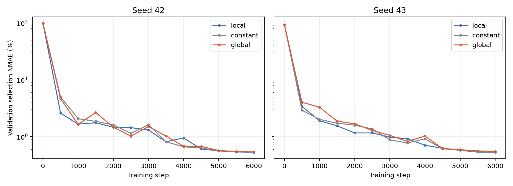

# Local/global 混合 embedding：查询网络压缩验证

本轮混合版较已优化原模型加速 4.24×，但测试 NMAE 为 0.548033%，纯小 local 为 0.534085%；混合版相对误差变化 +2.61%。是否值得采用须同时看速度和精度，不能将查询网络压缩的收益归因于 global 信息。

## 实测结果

误差为 8 个结构的空间测试 NMAE 宏平均；新训练模型再对两个随机种子取平均。时间为预先指定的种子 42，每结构三次中位数，再对 8 个结构取平均。

| 方法 | 测试 NMAE (%) | 新输入完整网格 (s) | 相对优化原模型加速 |
|---|---:|---:|---:|
| 原 DeepDFT（已优化推理） | 0.214090 | 3.529129 | 1.00× |
| 小 local | 0.534085 | 0.832139 | 4.24× |
| 小 local＋恒定条件 | 0.536790 | 0.831576 | 4.24× |
| 小 local＋global embedding | 0.548033 | 0.832528 | 4.24× |

原模型是既有 16000 步端到端训练检查点。小模型复用并冻结同一个原子编码器，从相同随机初始化训练查询头 6000 步；参照模型与新模型不是同训练预算比较。

## 两个种子分别报告

| 种子 | 方法 | 最优验证步 | selection NMAE (%) | test NMAE (%) |
|---:|---|---:|---:|---:|
| 42 | 小 local | 6000 | 0.533328 | 0.535452 |
| 42 | 小 local＋恒定条件 | 6000 | 0.534804 | 0.539337 |
| 42 | 小 local＋global embedding | 6000 | 0.539803 | 0.543934 |
| 43 | 小 local | 6000 | 0.531338 | 0.532718 |
| 43 | 小 local＋恒定条件 | 6000 | 0.534608 | 0.534244 |
| 43 | 小 local＋global embedding | 6000 | 0.553196 | 0.552133 |

## Global 信息是否有贡献

正的相对误差降幅表示 global 更好；负值表示更差。交换 global 为下一结构的 embedding 只作依赖诊断，不能单独证明模型学到了可泛化的全局物理。

| 种子 | 相对小 local 降幅 (%) | 相对恒定条件降幅 (%) | 交换 global 后测试 NMAE (%) |
|---:|---:|---:|---:|
| 42 | -1.584 | -0.852 | 0.549897 |
| 43 | -3.644 | -3.348 | 0.554917 |

## 结构与计算

- 原查询侧：3 层、128 通道。新查询侧：1 层、64 通道；4 Å 邻域和 30 维径向编码均保留。
- 原原子编码器 594688 参数，原查询侧 892545 参数。混合版查询侧 146337 参数，加同一个原子编码器共 741025 参数；纯 local 的启用参数共 724481。
- 三层原子标量/向量特征拼接，再分别投影到 64 通道；这些投影每结构只做一次。
- Global 描述：最终原子层标量均值、标准差和向量模长均值，共 384 维；无标签特征标准化后，经 32 维 MLP 瓶颈输出 128 个 FiLM 参数，每结构只算一次。
- 每点融合：s → s × (1 + 0.1 tanh(scale)) + shift，再由小 MLP 读出密度。无 SAD、密度插值或输出归一化。
- 恒定条件版本与 global 版本网络相同，但输入为固定零向量；其中部分权重没有有效自由度，因此它控制了额外条件模块，不代表严格相同有效容量。

| 新查询头 | 分配参数 | 可训练参数 |
|---|---:|---:|
| 小 local | 146337 | 129793 |
| 小 local＋恒定条件 | 146337 | 146337 |
| 小 local＋global embedding | 146337 | 146337 |

## 计时与数据边界

- RTX 5060 Ti，float32 网络、TF32 关闭；输入每结构 439040 点。
- 各方法预热后，同进程交错计时并显式 CUDA 同步。每次重建查询邻域和原子图、重新运行原子网络及所有 embedding、重建完整网格。
- 文件/检查点加载和已驻留输入传输不计入；训练时缓存的原子表示没有用于加速推理计时。
- 三组每个种子使用完全相同的训练点序列、优化器、步数和验证选择规则。所有种子训练结束后才读取测试指标；原检查点和划分哈希保存在 runs 中。
- 这里只测试 8 个已见结构的空间留出；global 表示可能编码结构身份。未验证未见结构、MD 新帧或 SCF 收敛，也未证明所有 local/global 架构的上限。
- 冻结原子编码器用于隔离查询头差异；结果不等同于从头端到端训练或共同微调的结果。

## 每结构测试误差

| 种子 | 结构 | local (%) | 恒定条件 (%) | global (%) |
|---:|---:|---:|---:|---:|
| 42 | 0 | 0.477055 | 0.478869 | 0.487551 |
| 42 | 1 | 0.370413 | 0.371205 | 0.375069 |
| 42 | 2 | 0.622420 | 0.621344 | 0.632136 |
| 42 | 3 | 0.614204 | 0.629366 | 0.623952 |
| 42 | 4 | 0.565830 | 0.570807 | 0.575726 |
| 42 | 5 | 0.705426 | 0.704979 | 0.711920 |
| 42 | 6 | 0.463136 | 0.468745 | 0.468678 |
| 42 | 7 | 0.465134 | 0.469381 | 0.476437 |
| 43 | 0 | 0.465574 | 0.471867 | 0.481576 |
| 43 | 1 | 0.366085 | 0.374323 | 0.381632 |
| 43 | 2 | 0.646578 | 0.640392 | 0.669090 |
| 43 | 3 | 0.569900 | 0.578157 | 0.603593 |
| 43 | 4 | 0.581225 | 0.577055 | 0.597171 |
| 43 | 5 | 0.694627 | 0.700542 | 0.721176 |
| 43 | 6 | 0.469203 | 0.474242 | 0.494423 |
| 43 | 7 | 0.468551 | 0.457374 | 0.468401 |

## 验证与复现

最终回归检查：5 项测试通过（tests/test_mixed_embedding.py 与 tests/test_deepdft_inference_fast.py）。

测试覆盖：周期 CSR 重复/乱序查询、旋转不变性、原子排列不变性、global 条件确实影响输出、恒定条件不受结构描述变化影响、梯度可达、初始预测匹配及分块一致性。正式全网格预测还逐结构核对了缓存评估与新输入路径的测试误差一致性。

```powershell
& 'C:/Users/User/.conda/envs/kan-cgcnn-cuda/python.exe' -m scripts.verify_mixed_embedding
& 'C:/Users/User/.conda/envs/kan-cgcnn-cuda/python.exe' -m scripts.summarize_mixed_embedding
```

训练曲线只使用验证 selection，不使用测试集调参。


