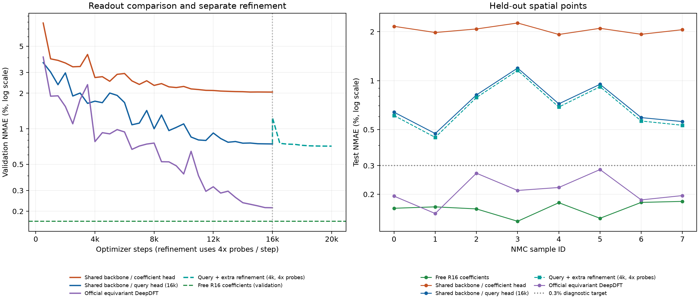

# NMC 表示与读出瓶颈诊断

实验始于 2026-10-27，2026-10-28 完成最终测试评价。目录日期保留实验起始日期。

本轮沿用既有空间划分，先完成 8 个结构的 R16 自由系数拟合，再训练同骨干的查询点读出，
最后按验证结果安排一次有固定预算的精修。

| 方案 | 训练点 NMAE | 验证点 NMAE | 测试点 NMAE |
|---|---:|---:|---:|
| R16 自由系数（逐结构拟合） | 0.14395% | 0.16327% | 0.16365% |
| 共同骨干＋R16 系数读出 | 2.07143% | 2.03957% | 2.06069% |
| 共同骨干＋查询点读出（16k，主对照） | 0.74399% | 0.73767% | 0.74323% |
| 查询点读出＋额外精修（非等预算） | 0.71353% | 0.70696% | 0.71268% |
| 官方等变 DeepDFT（参照） | 0.21129% | 0.21413% | 0.21409% |

指标是逐结构 `sum(abs(pred-target))/sum(abs(target))` 后宏平均，表中为百分数。
自由系数使用每个结构单独的一组系数，属于表示能力诊断，不是可从未知结构预测的模型。

## 结果解释

R16 自由系数测试误差为 **0.16365%**；同骨干查询点模型为 **0.74323%**，
相对于系数模型变化为 **63.93% 的误差下降**。
查询点读出在相同骨干与接近的参数预算下明显缩小了差距，支持优先研究系数输出与密度重构这条路径的学习瓶颈。

额外精修的测试误差为 **0.71268%**。仅按验证结果选定的最终查询模型为
“查询点读出＋额外精修（非等预算）”，测试误差 **0.71268%**，尚未达到约 0.3% 的阶段目标。
精修在主实验之外增加 4,000 步，每步 4,096 个训练点，总采样预算增加 16,384,000 个点，
等于主实验的采样总量；不能将精修结果归入等训练预算对照。

最终查询模型的训练与测试误差相近，当前差距更符合拟合能力或优化不足，而非明显的空间留出过拟合。
这次实验仍不能把查询模型与 DeepDFT 的剩余差距单独归因于骨干：两者的通道数、
查询头和参数量也不同，需要进一步控制这些因素才能定位。

## 对系数路线的意义

R16 带 1e-9 稳定项的最小二乘初始化尚未做 L1 精修时，固定验证子集的宏平均误差已为 **0.17860%**，
8 个结构均低于 0.3%。此时系数 RMS 为
0.643–1.260；
选择出的 L1 解系数 RMS 为
7.013–58.223。
因此，低于 0.3% 的表示能力并不依赖后期出现的大系数。

如果继续保留系数输出路线，下一项值得检验的是用仅由训练点拟合的较小范数最小二乘系数作预训练目标，
随后按重构密度误差微调，并比较密度度量下的系数监督与逐元素系数 MSE。
这是后续实验建议，本轮没有运行，也不保证能够达到 0.3%；单纯继续增加径向基数缺少本轮证据支持。

这些误差不能作为可加的“表示误差＋网络误差”分解。自由系数结果是实际找到的可行解，
不是最优误差的认证下界。查询模型是本项目新增的读出，官方 DeepDFT 仅作为参照。

下表均为最终测试分区：

| 样本 | R16 自由系数 | 系数读出 | 查询点读出 | 查询点精修 | 官方 DeepDFT |
|---|---:|---:|---:|---:|---:|
| 0 | 0.16403% | 2.15830% | 0.63968% | 0.61010% | 0.19481% |
| 1 | 0.16734% | 1.97754% | 0.47265% | 0.44760% | 0.15228% |
| 2 | 0.16254% | 2.07897% | 0.81653% | 0.78728% | 0.26956% |
| 3 | 0.13643% | 2.26285% | 1.19492% | 1.15525% | 0.21109% |
| 4 | 0.17746% | 1.92311% | 0.72002% | 0.68805% | 0.22012% |
| 5 | 0.14233% | 2.09847% | 0.94965% | 0.91726% | 0.28387% |
| 6 | 0.17825% | 1.92827% | 0.59241% | 0.56445% | 0.18467% |
| 7 | 0.18079% | 2.05799% | 0.55996% | 0.53144% | 0.19631% |

## 控制条件与泄漏检查

- 数据为原来的样本 0–7，每个 439,040 点；351,232 训练、43,904 验证、43,904 测试。
  原数据与划分 SHA256 保持一致，原固定的 8,192 个验证点用于选择模型。
- 自由系数的设计矩阵、归一化、Gram 预条件、最小二乘初始化及 L1 优化仅使用训练分区。
  依次使用 1e-3、1e-4、1e-5 平滑尺度，各最多 75 个 L-BFGS 内部迭代预算；每 25 步检查验证误差。
  没有导入历史完整网格 oracle 系数。Gram 中 1e-9 稳定项用于初始化求解和预条件，后续 L1 目标无 ridge 惩罚。
- 系数采用相同 R16、l≤4、3 Å、原点正则及径向白化。缓存用 float32 存储，Gram、优化变量和精确乘积用 float64；
  选出系数后通过独立的生产解码器重新评价验证点和最终三个分区。
- 两个读出的原子骨干均为原来 3 层、24/12/6 通道、6 Å 周期图，初始权重逐位相同，
  两者都只读取最后一层原子特征。端到端训练后骨干权重可以不同，并非冻结同一套已训练特征。
- 系数臂为 521,472 参数，查询臂为 519,248 参数，
  共同骨干为 338,928 参数。查询头为 3 层等变原子到查询点消息，
  采用 3 Å 平滑支持、不变标量/范数读出，不含查询点之间的消息。
- 两臂从头训练，均为 seed=42、16,000 步、每步 1,024 点、Adam、L1、学习率 1e-3 余弦到 1e-5、
  梯度范数截断 5、无 weight decay。结构顺序和训练点采样 RNG 相同，最终实际采样覆盖逐结构一致。
- 主实验查询验证误差从 14k 的 0.75474% 降至 16k 的 0.74369%，因此安排一次更大批量的低学习率精修。
  预算与选择规则在 `refinement_decision.json` 中提前固定：父模型为主查询臂的最佳权重，
  额外 4,000 步、每步 4,096 点、全参数 Adam、学习率 1e-4 余弦到 1e-6、seed=42。
  最佳精修步数为 4000；在父模型与精修检查点中仅按原验证子集选取。
  选择在 `2026-10-27T17:33:29.701220+00:00` 冻结，之后才评价本轮测试点，未按测试结果继续调整。
- 系数臂复用此前完全相同的 `r16_eight` 结果。新封装与生产前向/骨干梯度逐位一致，
  初始完整状态哈希与旧实验一致。`paired_control_audit.json` 记录数据、配置与权重检查。
  此前报告归档中的 23 个生产源文件与当前文件逐字节一致。
- 官方 DeepDFT 为 1,487,233 参数、4 Å 邻域，骨干不同，未并入“只改变读出”的受控结论。
- 测试点没有参与拟合、归一化、检查点选择或本轮改动决策；先保存训练结束记录，再单独运行最终评价。
  同一测试分区已在前一轮公开过，因此本轮结果是已有基准上的描述性比较，尚需新独立数据确认。
- 所有结果不做电荷重归一化或负密度截断。这里只检验已知结构内随机散布网格点的插值，
  不代表新结构、连续离网格点或大块空间空缺的泛化。
- 本轮只有一个随机种子和一组空间划分，没有据此作统计显著性结论。

## 复现

使用本项目 `kan-cgcnn-cuda` Python 环境，运行 `scripts/run_nmc_bottleneck.ps1` 完成拟合与查询训练。
然后运行 `powershell -ExecutionPolicy Bypass -File scripts/run_nmc_bottleneck_refine.ps1` 完成额外精修。
两次训练均完成后运行 `python -m scripts.finalize_nmc_bottleneck`，先冻结验证选择与检查点哈希，
再分别进行自由系数、主查询模型和精修模型的最终评价，并生成本报告。

运行目录为 `runs/nmc_bottleneck_2026-10-27`。各样本保存系数、验证历史和哈希，查询臂保存最佳/最后权重、
完整训练设置、采样审计与结果。本目录保存源代码快照、文件清单、汇总 JSON 与 PNG/PDF 图件。
新增测试覆盖系数布局导出、生产骨干值与梯度一致、旋转不变、重复/分批查询、梯度传播和 cutoff 连续性。
训练前的完整测试套件为 **51 passed**，日志存于运行目录的 `pytest.log`；此后未改动模型或求解器代码。
