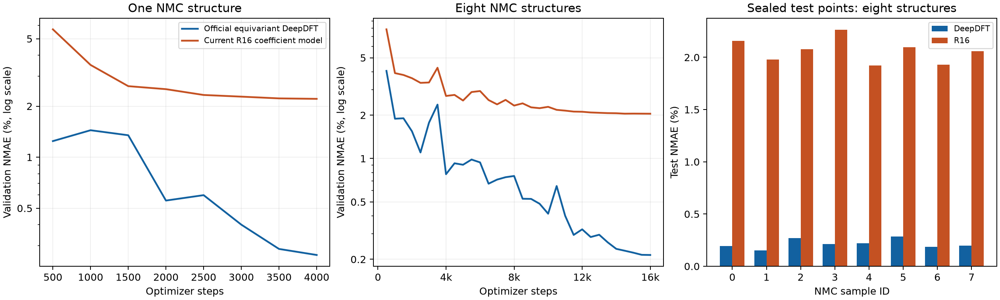

# NMC 新查询点实验：官方等变 DeepDFT 与当前 R16

报告日期：2026-10-27；实验于 2026-10-26 启动。此次为单种子、固定结构的空间留出诊断。先在样本 1 上从头训练，再在样本 0–7 上分别从头训练；8 结构实验没有继承单结构权重。

## 结果

| 训练范围 | 模型 | 训练点 NMAE | 验证点 NMAE | 最终留出点 NMAE | 完整网格 NMAE | 最佳步数 |
|---|---|---:|---:|---:|---:|---:|
| 1 个结构 | 官方等变 DeepDFT | 0.25281% | 0.25903% | 0.25609% | 0.25375% | 4000 |
| 1 个结构 | 当前 R16 | 2.16846% | 2.13243% | 2.13180% | 2.16121% | 4000 |
| 8 个结构 | 官方等变 DeepDFT | 0.21129% | 0.21413% | 0.21409% | 0.21185% | 16000 |
| 8 个结构 | 当前 R16 | 2.07143% | 2.03957% | 2.06069% | 2.06716% | 16000 |

8 结构配对的最终留出点上，DeepDFT 相对 R16 的误差下降为 **89.61%**，R16/DeepDFT 误差比为 **9.63**。各数值先逐结构计算 NMAE，再做宏平均，原始 JSON 保存比值。完整网格包含训练点，不能替代留出点结果。

DeepDFT 在 **8/8 个结构**上都取得更低的留出点误差；训练点宏平均 0.21129% 与留出点 0.21409% 接近。这支持直接查询点预测在这些已知 NMC 结构上的空间插值有效性。

NMAE = 查询点绝对误差之和 / 同一批查询点的真实密度绝对值之和。表中显示百分数；例如 JSON 中的 0.00214 对应约 0.214%。

| 样本 | DeepDFT 留出点 | R16 留出点 | DeepDFT 相对误差下降 |
|---|---:|---:|---:|
| 0 | 0.19481% | 2.15830% | 90.97% |
| 1 | 0.15228% | 1.97754% | 92.30% |
| 2 | 0.26956% | 2.07897% | 87.03% |
| 3 | 0.21109% | 2.26285% | 90.67% |
| 4 | 0.22012% | 1.92311% | 88.55% |
| 5 | 0.28387% | 2.09847% | 86.47% |
| 6 | 0.18467% | 1.92827% | 90.42% |
| 7 | 0.19631% | 2.05799% | 90.46% |

## 如何避免空间点泄漏

- 每个结构为 56×56×140 = 439,040 个原始 CHGCAR 网格点，密度单位为电子/ų。
- 按结构 ID 与种子 20261026，仅由索引随机划分：351,232 个训练点（80%）、43,904 个验证点（10%）、43,904 个最终测试点（10%）。单结构和 8 结构实验共用该结构的同一份划分。
- 每次更新只从训练分区均匀有放回抽 1,024 点。损失的归一化只使用训练分区的密度均值。
- 每 500 步用验证分区中的固定 8,192 点选择模型，第一步也检查。最终测试点没有参与梯度、学习率安排或 checkpoint 选择；训练全部结束并载入已选模型后，才遍历全部网格并分别统计三个分区。
- `sampling_audit.json` 记录实际访问过的训练点，所有验证/测试点的梯度使用次数均为零。周期几何缓存可包含查询坐标，但不包含密度标签，查询点之间不传递消息。
- 使用从头训练的 R16 作为公平对照。旧 R16 checkpoint 曾在完整网格上训练/选择，不能声称其在这些点上的结果是空间留出成绩。

## 模型和预算

- DeepDFT 直接导入官方 `PainnDensityModel`，提交 `a6bab4deb5cf05d9b46ae397b72253d04ea3c694`，3 层、128 通道、4 Å cutoff、30 个 sinc 径向输入；30 是官方代码与发布 NMC 模型的设置。没有修改官方 `densitymodel.py` 或 `layer.py`，没有使用预训练权重初始化正式实验。
- 使用 cKDTree 枚举全部周期像作为数据适配器；官方网络仍自行计算相对坐标、径向特征、消息和标量密度。未安装的 asap3 仅属于官方数据加载路径的邻居搜索依赖，不影响直接使用官方模型。
- R16 保持当前模型的 24/12/6 通道、3 层、6 Å 原子图和 l≤4 正则白化密度基，密度 cutoff 3 Å。新增缓存与生产解码器的值及系数梯度已做独立一致性测试。
- 参数量：DeepDFT 为 1,487,233，R16 为 521,472；R16 的可学习原子基线也从头训练。
- 两种模型均采用密度归一化 L1、Adam、初始学习率 1e-3、余弦衰减到 1e-5、无 weight decay、梯度范数截断 5。单结构 4,000 步，8 结构 16,000 步，seed=42；配对的结构顺序与采样序列相同。
- 评价原始网络输出，不做电荷重归一化或负密度截断。
- 这是统一预算的本地诊断，使用官方架构，但训练协议不同于官方论文的大数据 MSE/学习率协议，不能称作完整论文复现。两模型参数量和单步计算量不相等。
- 官方预训练 NMC 模型仅在训练分区的 4,096 点上做输入格式检查，NMAE 0.04310%；检查权重和 20 步吞吐预实验权重均被丢弃，不进入正式模型。

## 结论边界

本实验检验已知结构中未用于优化的新空间网格点，属于空间插值；不是新材料、新结构或离开原始网格的连续坐标泛化。随机散布留出点的相邻网格可能属于训练集，因此不能把结果解释成大块未知区域的外推能力。

这 8 个结构此前用于项目的基组与过拟合研究。因此这里的“留出”严格指本轮从头训练、归一化和 checkpoint 选择没有使用该分区标签，并不意味着这些结构的密度从未在项目历史中被查看。

单个随机种子和有限训练预算不能证明架构最优精度。后续应在正式结构划分上检验泛化，再比较完整场生成成本及 SCF；本轮没有启动完整 NMC 训练或 VASP。

这也是两套完整架构的比较：骨干、参数量、邻域和读出都不同，不能将全部误差差异单独归因于查询点读出。若要定位收益来源，应随后做相同骨干的读出消融。

## 复现与来源

使用 `C:\Users\User\.conda\envs\kan-cgcnn-cuda\python.exe`，运行 `scripts/run_nmc_probe_holdout.ps1`，再运行 `python -m scripts.summarize_nmc_probe_holdout`。训练脚本支持严格设置检查和断点恢复；流水线会跳过已完成的结果。实验输出在 `runs/nmc_probe_holdout_2026-10-26`，四组目录均保存 `best.pt`、`last.pt`、设置、采样记录与结果。

已完成 47 项测试，包括新增的空间划分互斥、独立 ASE 周期邻居对照、官方网络旋转/查询分批一致性，以及 R16 缓存的值和梯度对照。报告生成时再次核验了原始数据、划分数组、训练入口、官方模型文件和最佳 checkpoint 的哈希，以及配对训练设置、采样记录和验证集模型选择。

本目录的 `source_snapshot.zip` 保存源代码快照，`manifest.json` 保存文件哈希，`summary.json` 汇总原始指标，`comparison.png` / `comparison.pdf` 为图件。正式实验使用 PyTorch 2.11.0+cu128 和 RTX 5060 Ti；机器上有其他任务，因此运行时间不用于速度排名。

[DeepDFT 原文](https://www.nature.com/articles/s41524-022-00863-y) · [官方代码](https://github.com/peterbjorgensen/DeepDFT)
