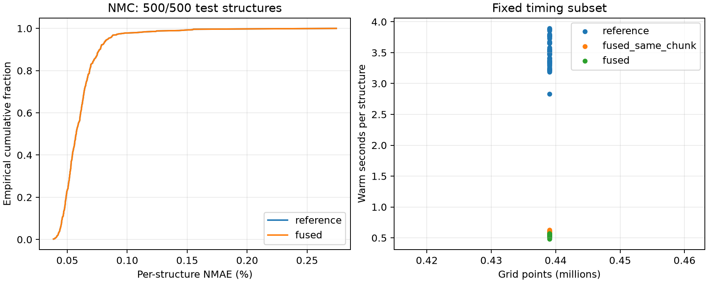

# NMC public pretrained benchmark

Results are generated from saved observations. Missing cases are not extrapolated.
Protocol: [protocol.md](protocol.md). Hardware: RTX 5060 Ti 16 GB; FP32, TF32 off.
Reference = official network algebra through the local FlatProbe adapter; not the unmodified upstream CLI.
Warm seconds are per full material structure, excluding file parsing and one-time model/kernel setup.

## Training-frame preflight (not official test results)

| Variant | Chunk | NMAE (%) | Median seconds | Relative L1 vs reference |
|---|---:|---:|---:|---:|
| reference | 4096 | 0.0524507 | 3.8743 | 4.58e-08 |
| fused | 4096 | 0.0524501 | 0.6666 | 1.28e-07 |
| fused | 8192 | 0.0524501 | 0.5946 | 1.27e-07 |

## Official test-set density accuracy

Attempted 500/500; successful 500; errors 0; loop completed: True.

| Variant | Mean NMAE (%) | Median (%) | p95 (%) | Maximum (%) |
|---|---:|---:|---:|---:|
| reference | 0.0609834 | 0.0574587 | 0.0841401 | 0.2743762 |
| fused | 0.0609830 | 0.0574585 | 0.0841399 | 0.2743753 |

Numerical-agreement failures: 0; maximum relative L1: 1.315e-07.
Mean fused minus reference NMAE: -4.107e-07 percentage points; descriptive bootstrap 95% interval: [-4.455755980430846e-07, -3.7616430612857897e-07].
EC frames are correlated trajectory samples; bootstrap intervals do not establish independent-material generalization.

## Fixed 50-structure timing subset

| Variant | Successful / attempted | Median of medians (s) | Mean (s) | p95 (s) | Maximum allocated GiB |
|---|---:|---:|---:|---:|---:|
| reference | 50 / 50 | 3.4800 | 3.4878 | 3.8652 | 1.716 |
| fused_same_chunk | 50 / 50 | 0.5773 | 0.5781 | 0.6094 | 1.786 |
| fused | 50 / 50 | 0.5353 | 0.5363 | 0.5666 | 1.786 |

fused_same_chunk: 50 paired timing structures; median speedup 6.006x; ratio of summed times 6.033x.

fused: 50 paired timing structures; median speedup 6.483x; ratio of summed times 6.504x.

Complete and all checks passed: **True**.
This is a density-only inference benchmark; it does not measure PAW occupation accuracy, SCF iterations or total DFT runtime.
A matched public pretrained EdenGNN NMC/EC baseline is not available in the inspected release.
See per-structure JSON for failures, worst IDs, pooled errors, memory and all timing repetitions.

