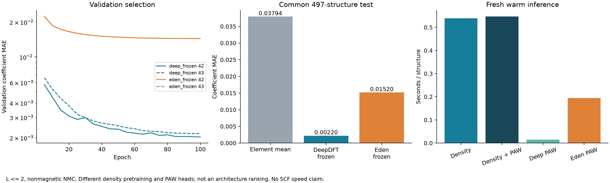

# 官方预训练 DeepDFT 的完整 NMC occupation 实验

日期：2026-11-02。已完成可用标签范围内的训练、独立测试、联合推理验证与计时。
DeepDFT 两种子平均测试 MAE **0.002202**，相对 L1 **0.816%**；
相对元素均值基线，MAE 降低 **94.19%**。
密度＋occupation 平均耗时 **0.5463 秒/结构**。
这不是完整高阶 PAW 或 VASP SCF 加速的验证。

## 实验设计与数据

- 官方全部 2000 个 NMC 结构，1450 训练 / 50 验证 / 500 测试，按结构划分。
- 每个文件的原生 PAW 槽位与 POTCAR 投影子顺序完成解析；归档 MD5、划分及模型哈希复核通过。
- 全集 L=3、4 均为零，只将 L≤2 当作有效标签。未把高阶零输出计入精度。
- DeepDFT 使用官方 NMC 密度预训练模型；冻结密度网络，仅训练 49,899 参数的几何等变头。
- Eden 使用官方编码器/augmentation 架构的本地 8 结构密度预训练权重，冻结编码器并重新训练 occupation 头。它不是论文通用模型的复现。
- Eden 密度预训练见过官方测试结构 [1, 3, 6]，因此其测试剔除这些结构，两个模型的共同对比为 497 个结构。预训练数据和输出头规模不同，不作架构优劣结论。
- 两臂各 seed 42/43，100 epoch，batch 16，Adam 1e-3→1e-5，裁剪 5；同种子同采样顺序。每 5 epoch 验证，全部四个检查点锁定后才打开新测试指标。
- 元素均值、张量缩放和 Eden 特征 RMS 仅来自训练集；每个张量块所有 m 共用缩放。训练可缓存冻结特征；正式测试重新计算原子特征。
- 该公开测试划分此前用于密度 benchmark，部分结构用于历史小规模方法开发；本轮按固定协议重新训练和评估，并非全新盲测。

## 完整测试结果

| 方法 | 训练 MAE | 验证 MAE | 测试 MAE | 测试相对 L1 (%) | 测试结构数 |
|---|---:|---:|---:|---:|---:|
| 元素均值基线 | — | — | 0.037921 | 14.023 | 500 |
| deep_frozen / 42 | 0.002089 | 0.002035 | 0.002156 | 0.799 | 500 |
| deep_frozen / 43 | 0.002193 | 0.002178 | 0.002248 | 0.833 | 500 |
| eden_frozen / 42 | 0.014912 | 0.014448 | 0.015197 | 5.620 | 497 |
| eden_frozen / 43 | 0.014921 | 0.014458 | 0.015206 | 5.624 | 497 |

MAE 是有效原子中心 augmentation 系数的无量纲误差。相对 L1 的分母是这些系数绝对值之和；不是电子密度 NMAE。先逐结构计算再平均。两个种子均报告，不按测试集挑选。

## 排除预训练重叠后的共同测试集

| 方法 | 共同测试 MAE（两种子均值） | 相对 L1 (%) |
|---|---:|---:|
| deep_frozen | 0.002204 | 0.817 |
| eden_frozen | 0.015202 | 5.622 |

| 方法 | L=0 MAE | L=1 MAE | L=2 MAE | L>0 相对 L1 (%) |
|---|---:|---:|---:|---:|
| deep_frozen | 0.003183 | 0.000552 | 0.002952 | 5.639 |
| eden_frozen | 0.034119 | 0.004508 | 0.016549 | 32.641 |

| 元素 | DeepDFT pooled MAE | Eden pooled MAE |
|---|---:|---:|
| Li | 0.000233 | 0.002482 |
| O | 0.000431 | 0.003116 |
| Mn | 0.004997 | 0.037615 |
| Co | 0.003039 | 0.020875 |
| Ni | 0.003311 | 0.019257 |

元素列按共同测试集有效系数汇总（pooled），合并两个种子的误差后除以系数数目；不与按结构平均的 MAE 混用。

完整逐结构、逐元素、逐角阶以及 pooled 指标在原始 final JSON 中。小规模历史实验的数值不与这次完整划分直接混合。

## 训练记录

| 模型 / 种子 | 验证选择 epoch | 可训练参数 | 训练秒数 |
|---|---:|---:|---:|
| deep_frozen / 42 | 100 | 49899 | 340.7 |
| deep_frozen / 43 | 95 | 49899 | 133.7 |
| eden_frozen / 42 | 100 | 946 | 118.9 |
| eden_frozen / 43 | 100 | 946 | 121.6 |

每种子 100 个完整 epoch，共 9100 次参数更新、145000 个训练结构呈现。两个种子只提供本次训练重复性信息，不构成统计置信区间。
训练秒数不含数据解析、冻结特征准备或模型设置，受桌面环境状态影响，不能用它直接推断架构 FLOPs 优势。

## 联合推理性能

| 路径 | 平均秒/结构 | 结构中位数的中位数 (s) | 最大增量显存 (GiB) | 结构数 |
|---|---:|---:|---:|---:|
| density | 0.538770 | 0.539428 | 1.692 | 50 |
| joint | 0.546317 | 0.546438 | 1.692 | 50 |
| deep_occupation | 0.014937 | 0.014550 | 0.014 | 50 |
| eden_occupation | 0.194617 | 0.195742 | 0.511 | 50 |

RTX 5060 Ti，FP32，TF32 关闭；密度保留全部 4 Å 邻居、128 通道，融合分块 8192。
固定使用既有的 50 测试结构计时名单；occupation 对照只使用其共同测试子集。
每条路径独立进程，每结构预热 2 次、同步重复 5 次，先取中位数再平均。
每次重新构图、编码原子并预测；联合路径共享一次编码。不计文件读取、导入、模型加载、一次性表和 kernel 设置或写盘。
两条路径的独立中位数之差不是 occupation 的精确新增开销。设置时间保存在 timing JSON，不能把本表当作进程冷启动或完整 DFT 时间。

## 密度保持与正确性

50 个固定测试结构的完整网格逐点核对通过；联合融合输出相对原官方网络代数路径最大归一化 L1 差为 **1.31e-07**。
这 50 个结构的平均密度 NMAE 为 reference **0.0704522%**、joint **0.0704519%**。
密度 checkpoint 未修改；这里是 50 结构新增联合核对，官方 500 结构密度测试见上一轮公开 benchmark，不能把本轮子集均值叫作 500 结构均值。
真实结构旋转/反演/平移 occupation 检查、缓存/新算特征输出一致性、不同大小结构合批预测与梯度等价性、原生槽位往返和有效掩码均已检查。
合批梯度与 PAW/Eden 等变测试共 4 项通过。POSCAR 独立入口已用测试结构 41 核对：密度、occupation 与直接几何调用在预设容差内一致，原生次序映射完全一致，有效掩码与源标签匹配。详情见 `poscar_export_validation.json`。

## 尚不能据此回答的问题

现有标签未提供可认证的 L=3、4 高阶系数；历史原始 POTCAR 完整身份不能从 CHGCAR 单独恢复；目前只支持非磁性 Li/O/Mn/Co/Ni。
当前环境 PATH 未发现可执行 VASP，WSL 也未安装。因此没有 SCF 步数、总 DFT 墙钟时间、最终能量/力一致性结果。
没有把真实 augmentation 拼入预测后称作完整模型，也没有把只保留真实密度的 occupation 替换文件称作完整 ML 初猜。
扩大到 EC、磁性材料或完整 LMAXMIX=4，需要分别准备元素/自旋/高阶映射和可靠标签。

## 使用与复现

`PublicPAWPredictor(seed=42).predict(geometry)` 返回 density、canonical augmentation、supported_lmax=2。
geometry 只包含 positions、numbers、cell、probes、metadata；输入来自当前 CUDA 上的完整规则周期网格。
占据分支单独调用可设置 `density=False`，只需 positions/numbers/cell。高阶占位不能当作完整 PAW 重启数据。

仅从 POSCAR 推理：`python -m scripts.predict_public_paw --structure <POSCAR> --grid 56 56 140 --output <prediction.npz>`。
输出包括密度、canonical 与本地 POTCAR 原生顺序的 occupation，以及有效掩码。该 NPZ 不是完整 VASP 重启 CHGCAR。

训练与准备：`python -m scripts.public_paw_experiment --stage audit/prepare/train`，配合 `--arm deep_frozen/eden_frozen --seed 42/43`。
最终评估：`python -m scripts.finalize_public_paw --stage final/verify/timing`；汇总：`python -m scripts.summarize_public_paw`。
已有数据与正式结果禁止覆盖；训练中断可从 last.pt 恢复。新实验应新建独立目录并锁定协议。
协议为 protocol.md；原始结果、审计、训练历史和模型见 `runs/public_paw_2026-11-02`。
